# Exploración de la planificación de procesos en XV6

**Curso:** Sistemas Operativos — Universidad del Valle — 2026-2
**Integrantes:** Anthony Alejandro Mora Melo · Roiban Alirio Bastidas Rosales
**Repositorio (fork):** https://github.com/alejandrmora777/xv6-riscv

---

## 1. Repositorio y entorno

### 1.1 Versión de Linux y commit de partida

| Dato | Valor |
| --- | --- |
| Entorno de trabajo | Google Cloud Shell |
| Sistema operativo | Ubuntu 24.04.5 LTS (Noble Numbat) |
| Kernel / arquitectura (`uname -srm`) | Linux 6.18.55+ x86_64 |
| Repositorio original | https://github.com/mit-pdos/xv6-riscv (rama `riscv`) |
| Commit de partida | `fa2ddcb7ca87a77af579380a6eafd5aff163b44f` — *usertests: bound the zero-length pipe read regression test* |

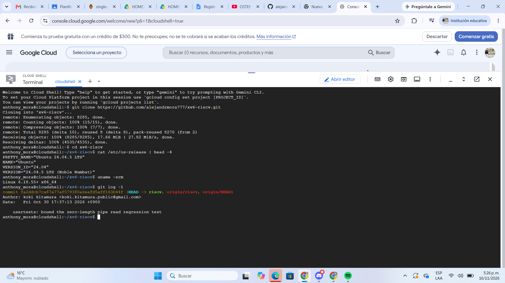

### 1.2 Herramientas y versiones

| Herramienta | Para qué sirve | Versión |
| --- | --- | --- |
| `riscv64-linux-gnu-gcc` (y `binutils-riscv64-linux-gnu`) | Compilador cruzado: compila el código C de XV6 para la arquitectura RISC-V desde una máquina x86-64; incluye el enlazador `ld`, `objdump` y `nm` | 13.3.0 (Ubuntu 13.3.0-6ubuntu2~24.04.1) |
| `qemu-system-riscv64` (paquete `qemu-system-misc`) | Emulador que simula una máquina RISC-V (`-machine virt`) donde arranca XV6 | 8.2.2 (Debian 1:8.2.2+ds-0ubuntu1.18) |
| GNU Make | Ejecuta las reglas del `Makefile` para compilar, enlazar y arrancar XV6 | 4.3 |
| git | Clonar el fork y consultar el commit de partida | 2.43.0 |
| `bc` | Lo usa el `Makefile` para comparar la versión de QEMU | — |

Instalación (instrucciones reproducibles):

```bash
sudo apt update
sudo apt install -y build-essential gcc-riscv64-linux-gnu binutils-riscv64-linux-gnu qemu-system-misc bc
```

**Nota sobre el entorno:** el `Makefile` de XV6 exige QEMU ≥ 7.2 (`MIN_QEMU_VERSION = 7.2`). La máquina virtual de Vagrant usada en clase es Ubuntu 22.04, que trae QEMU 6.2, por lo que `make qemu` fallaría con `ERROR: Need qemu version >= 7.2`. Por eso usamos Google Cloud Shell (Ubuntu 24.04, QEMU 8.2.2). Como Cloud Shell borra los paquetes instalados con `apt` cuando la sesión se reinicia (nos pasó dos veces), hubo que repetir la instalación; la carpeta del repositorio sí se conserva.

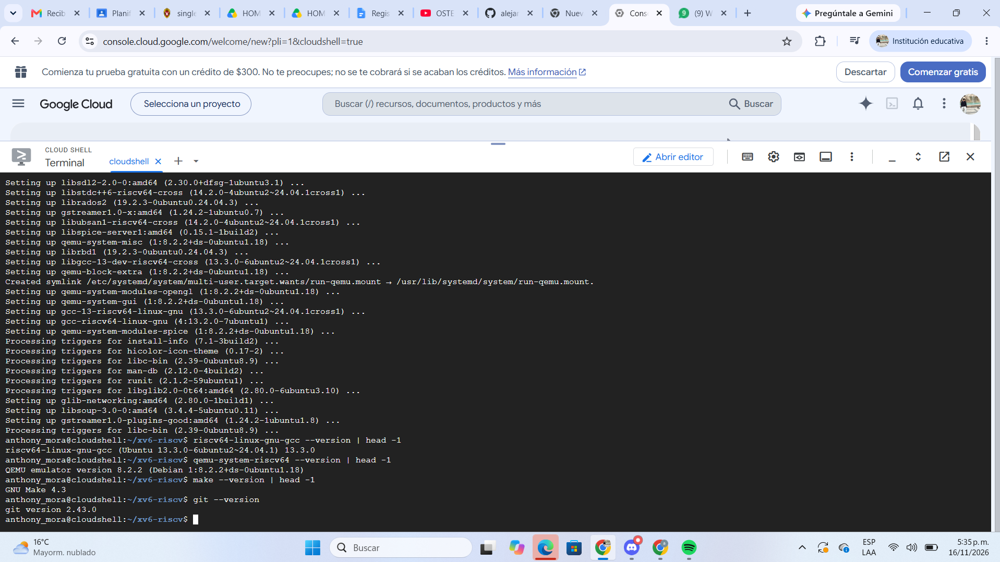

---

## 2. Compilación y ejecución de XV6

### 2.1 XV6 operativo

```bash
git clone https://github.com/alejandrmora777/xv6-riscv.git
cd xv6-riscv
make qemu        # compila y arranca XV6; para salir: Ctrl+A y luego X
```

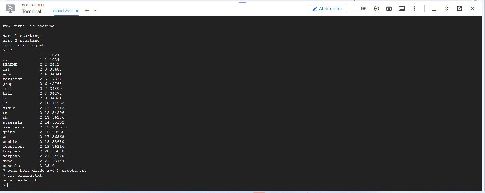

La imagen muestra que XV6 arranca en QEMU: aparece el mensaje `xv6 kernel is booting`, luego `hart 1 starting` y `hart 2 starting` (las CPU virtuales 1 y 2; la CPU 0 es la que arranca el kernel) e `init: starting sh`. En la consola de XV6 ejecutamos `ls` (lista los programas y archivos del sistema de archivos de XV6), creamos un archivo con `echo hola desde xv6 > prueba.txt` y lo mostramos con `cat prueba.txt`.

### 2.2 Ejecución con una sola CPU virtual

Para saber dónde se configura el número de CPU buscamos `CPUS` en el `Makefile` (`grep -n "CPUS" Makefile`):

```make
174: ifndef CPUS
175: CPUS := 3
178: QEMUOPTS = -machine virt -bios none -kernel $K/kernel -m 128M -smp $(CPUS) -nographic
```

Si no se indica otra cosa, `CPUS` vale 3, y ese valor se le pasa a QEMU con la opción `-smp`, que define cuántos procesadores tiene la máquina emulada.

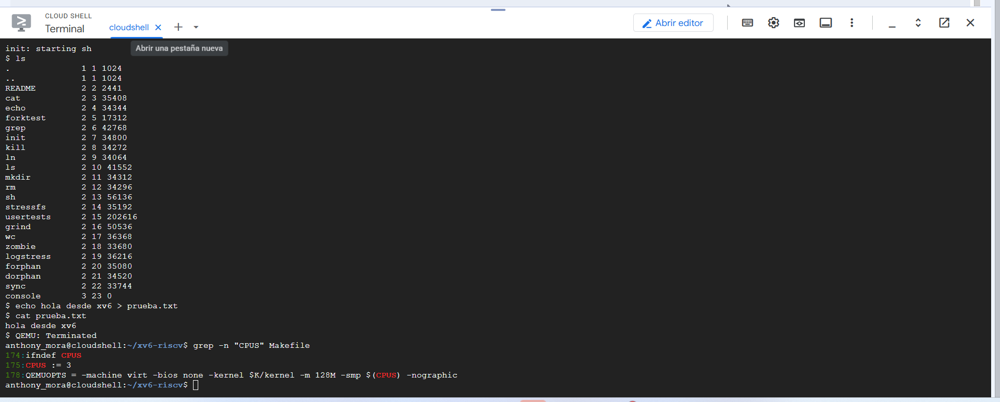

Comando utilizado:

```bash
make qemu CPUS=1
```

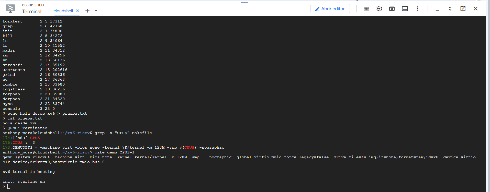

**Evidencia:** el comando que imprime `make` muestra `-smp 1`, y en el arranque ya no aparecen las líneas `hart 1 starting` ni `hart 2 starting` (comparar con la imagen de 2.1): solo existe la CPU 0.

---

## 3. El planificador original de XV6

### 3.1 ¿Qué algoritmo de planificación usa XV6 por defecto?

Creemos que XV6 utiliza un algoritmo de **Round-Robin (RR)** con un quantum de tiempo (*time slice*), sin prioridades.

**Experimento.** Agregamos un programa de prueba, `user/spin.c`, que solo gasta CPU y cada cierto trabajo imprime su PID (lo agregamos a `UPROGS` en el `Makefile`). Con una sola CPU (`make qemu CPUS=1`) lanzamos tres copias a la vez con `spin &; spin &; spin &` y presionamos Ctrl+P (que ejecuta `procdump()` y lista los procesos con su estado).

```c
// user/spin.c (programa de prueba; no modifica el planificador)
#include "kernel/types.h"
#include "user/user.h"

int
main(int argc, char *argv[])
{
  int pid = getpid();
  for (int i = 1; i <= 5; i++) {
    for (volatile int j = 0; j < 100000000; j++) {
    }
    printf("pid %d: vuelta %d\n", pid, i);
  }
  exit(0);
}
```

```bash
sed -i 's|\t$U/_sync\\|\t$U/_sync\\\n\t$U/_spin\\|' Makefile   # agrega $U/_spin a UPROGS
make qemu CPUS=1
# dentro de XV6:
spin &; spin &; spin &
```

(La shell de XV6 no acepta `spin & spin &`; hay que separar los comandos con `;`.)

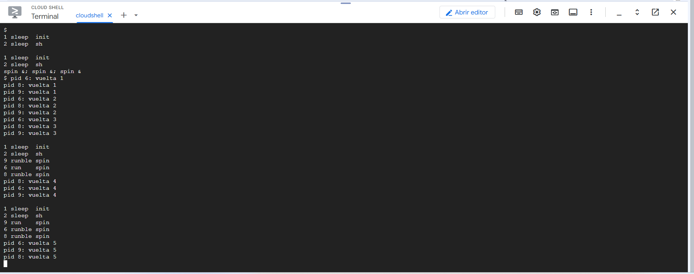

**Qué muestra la evidencia.** Si el algoritmo fuera FIFO (por orden de llegada estricto), el primer proceso en ejecutarse (por ejemplo, el PID 6) habría acaparado la CPU hasta terminar sus 5 vueltas completas, y solo después el sistema habría ejecutado el PID 8 (sus 5 vueltas) y luego el PID 9: veríamos las líneas agrupadas por proceso. En la práctica las líneas se ven intercaladas: la `vuelta 1` del PID 6, luego la del PID 8, luego la del PID 9, y así sucesivamente. Esto muestra que el planificador le quita la CPU a un proceso después de un tiempo y se la pasa al siguiente, dándoles a todos la oportunidad de avanzar en turnos rotativos.

Al presionar Ctrl+P, XV6 imprime la tabla de procesos. Como configuramos QEMU con una sola CPU, en cada lista hay **un solo proceso en `run`** y los demás `spin` en `runble` (listos, esperando turno); `init` y `sh` están en `sleep`. Entre el primer y el segundo Ctrl+P el proceso en `run` cambió (PID 6 y luego PID 9): el turno rota.

**Observación adicional (hipótesis).** En las primeras vueltas el orden fue 6, 8, 9, pero en la vuelta 4 fue 8, 6, 9 y en la vuelta 5 fue 6, 9, 8. Nuestra hipótesis (afinada con pistas de la IA) es que se debe a la interacción con la consola y a que una vuelta dura más de un quantum. Los `spin` casi nunca dejan de estar listos; lo único distinto que hacen es el `printf` al terminar una vuelta, que escribe en la consola (E/S). Como una vuelta equivale a una cantidad fija de trabajo que dura varios quantums, el momento en que termina no coincide con el final de su turno. Al imprimir, el proceso puede quedar brevemente en `SLEEPING` esperando a la consola; si en ese momento el planificador busca el siguiente proceso, pasa al siguiente disponible y el orden cambia. En la sección 3.3 vimos que el código respalda esta posibilidad (`kernel/uart.c`, líneas 89-91), aunque no comprobamos que eso fue exactamente lo que ocurrió en nuestro experimento.

### 3.2 ¿En qué archivo y función se selecciona el siguiente proceso?

En el archivo **`kernel/proc.c`**, función **`scheduler()`** (línea 429). El sistema revisa toda la lista de procesos y solo lleva a la CPU a aquel que tenga el estado `RUNNABLE` (el que está listo y esperando su turno).

Los revisa en orden, de principio a fin, con un ciclo `for` que va desde el primer proceso (`proc`) hasta el último (`&proc[NPROC]`). No hay prioridades: toma el primer proceso que encuentre listo. Esto produce un comportamiento Round-Robin porque, cuando el proceso actual se pausa, el ciclo sigue buscando desde donde iba, y así todos se turnan la CPU de forma circular. Al llegar al final de la tabla, el ciclo infinito `for (;;)` vuelve a empezar desde `proc[0]`: el turno circular sale de recorrer la tabla una y otra vez, no de una cola de espera.

```c
// kernel/proc.c — scheduler() (fragmento)
  for (;;) {
    intr_on();
    intr_off();

    int found = 0;
    for (p = proc; p < &proc[NPROC]; p++) {
      acquire(&p->lock);
      if (p->state == RUNNABLE) {
        p->state = RUNNING;
        c->proc = p;
        swtch(&c->context, &p->context);   // cambio de contexto al proceso elegido
        mycpu()->intena = 0;
        c->proc = 0;                       // el proceso devolvió la CPU
        found = 1;
      }
      release(&p->lock);
    }
    if (found == 0) {
      asm volatile("wfi");                 // nada que ejecutar: esperar interrupción
    }
  }
```

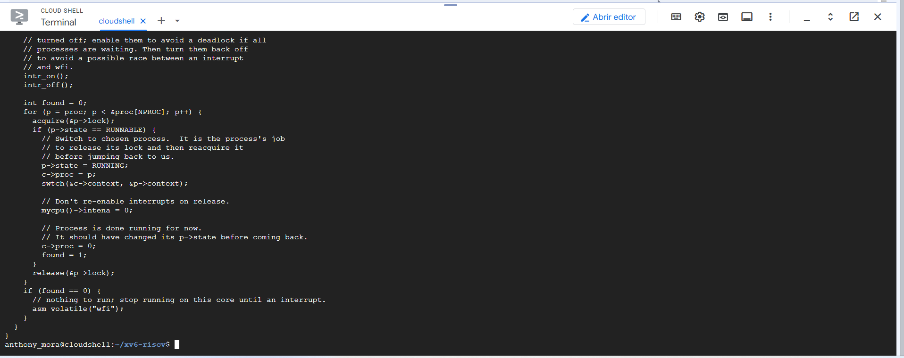

### 3.3 Relación con los estados de los procesos y con los eventos que ceden o recuperan la CPU

**¿Qué evento le quita la CPU a un proceso como `spin`?** A los procesos `spin` los frena el reloj del sistema. En `kernel/trap.c` (cuando `which_dev == 2`, líneas 85-86 en `usertrap()` y 157-158 en `kerneltrap()`), el sistema detecta que llegó la interrupción del temporizador y llama a `yield()`, que pone al proceso como `RUNNABLE`; esta a su vez llama a `sched()`, que con `swtch()` regresa el control a `scheduler()`. `clockintr()` programa la siguiente interrupción con `w_stimecmp(r_time() + 1000000)`; según el comentario del código, 1 000 000 es aproximadamente una décima de segundo: ese es el quantum de XV6.

```c
// kernel/trap.c
85:  if (which_dev == 2)
86:    yield();
...
157:  if (which_dev == 2 && myproc() != 0)
158:    yield();

// kernel/trap.c — clockintr()
  w_stimecmp(r_time() + 1000000);   // "1000000 is about a tenth of a second"

// kernel/proc.c — yield()
  acquire(&p->lock);
  p->state = RUNNABLE;
  sched();
  release(&p->lock);

// kernel/proc.c — sched() (fragmento)
  swtch(&p->context, &mycpu()->context);   // vuelve a scheduler()
```

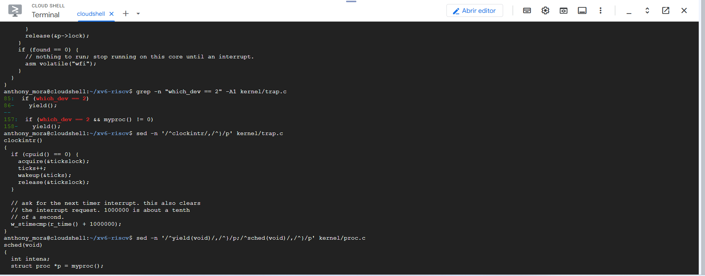

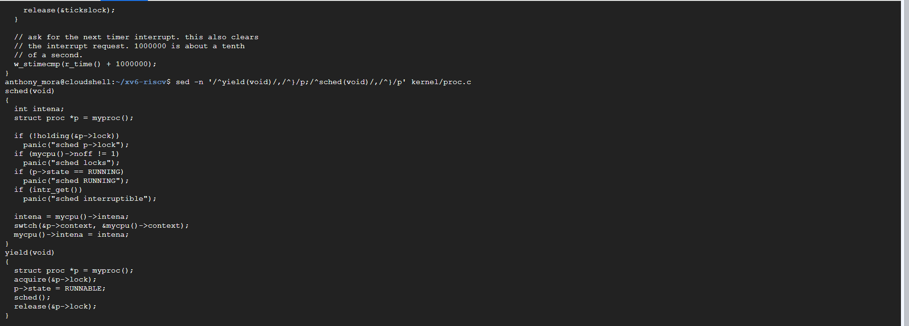

**Diferencia entre `yield()` y `sleep()`.** La gran diferencia está en el estado final: `yield()` deja el proceso en `RUNNABLE` (listo para su próximo turno), mientras que `sleep()` lo deja en `SLEEPING` (pausado). A `scheduler()` esto le importa porque su ciclo solo busca procesos `RUNNABLE`; si el proceso está dormido, lo ignora por completo.

**`wakeup()`.** `wakeup(chan)` recorre la tabla de procesos buscando a los que esperan en un canal específico, les borra ese canal y los pasa de `SLEEPING` a `RUNNABLE`. El proceso vuelve a ser candidato para la CPU en ese momento, porque al quedar `RUNNABLE` el planificador lo puede elegir en su siguiente recorrido.

```c
// kernel/proc.c — sleep()
  acquire(&p->lock);
  if (p->chan != 0) {
    p->state = SLEEPING;
    sched();
  }
  release(&p->lock);

// kernel/proc.c — wakeup(chan) (fragmento)
    if (p->chan == chan) {
      p->chan = 0;
      if (p->state == SLEEPING) {
        p->state = RUNNABLE;
      }
    }
```

**Nuestra hipótesis del orden de las vueltas.** Queda **apoyada por el código** (no confirmada al 100 %). En `kernel/uart.c` vimos que si la consola está ocupada, la escritura puede mandar al proceso a dormir esperando en `tx_chan`:

```c
// kernel/uart.c — uartwrite()
89:      sleep_prepare(&tx_chan);
91:      sleep();
```

Así que es probable que eso desordenara las vueltas, pero no lo medimos directamente.

**Diferencia con el libro.** Nuestra versión del código usa `sleep_prepare(chan)` seguido de `sleep()`, distinto al `sleep(chan, lock)` que describe el libro de XV6. Nos basamos en lo observado en el commit `fa2ddcb`.

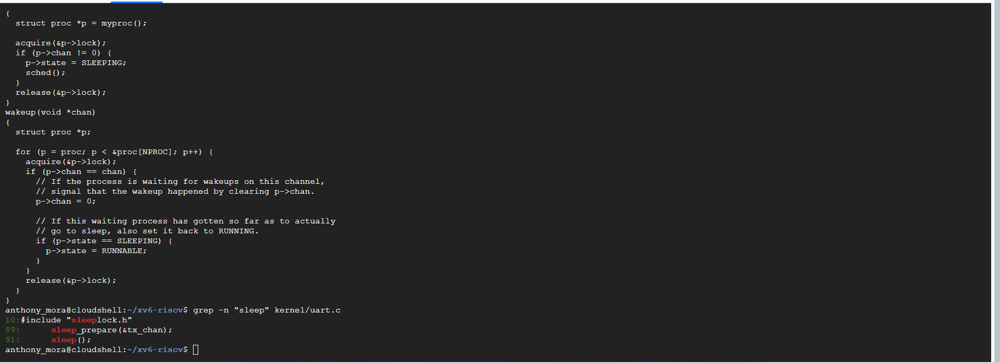

**Resumen del ciclo:**

```
scheduler() elige un RUNNABLE ──► RUNNING ──┬─ interrupción del reloj ─► yield()  ─► RUNNABLE ─┐
       ▲                                   └─ espera E/S u otro evento ─► sleep() ─► SLEEPING ─┤
       │                                                                                       │
       └──────────────────────── sched() ─► swtch() de vuelta al planificador ◄────────────────┘
                     (más tarde, wakeup(chan) pasa SLEEPING ─► RUNNABLE)
```

### 3.4 ¿Cómo se incorpora el planificador al sistema compilado?

Primero, `kernel/proc.c` pasa por el compilador (`riscv64-linux-gnu-gcc`) y se transforma en un archivo objeto, `kernel/proc.o`. Luego ese archivo se junta con todos los demás `.o` para crear un único binario final, `kernel/kernel`. Finalmente, al ejecutar `make qemu`, QEMU toma ese archivo (`-kernel kernel/kernel`, ver imagen 2.2) y lo carga en memoria para arrancar el sistema operativo.

La lista `OBJS` es como la "lista de empaque": dice exactamente qué archivos objeto (como `proc.o`, `trap.o`, `swtch.o`, etc.) deben incluirse en el kernel. `kernel/kernel.ld` es el "plano de construcción" (*linker script*) que le indica al enlazador en qué direcciones de memoria acomodar cada parte del código.

```make
# Makefile
4:  OBJS = \
      ...
      $K/proc.o \
      $K/swtch.o \
      $K/trap.o \
      ...

94: $K/kernel: $(OBJS) $K/kernel.ld
	$(LD) $(LDFLAGS) -T $K/kernel.ld -o $K/kernel $(OBJS)
	$(OBJDUMP) -S $K/kernel > $K/kernel.asm
	$(OBJDUMP) -t $K/kernel | sed '1,/SYMBOL TABLE/d; s/ .* / /; /^$$/d' > $K/kernel.sym
```

```text
$ ls -l kernel/proc.c kernel/proc.o kernel/kernel
-rwxrwxr-x 1 anthony_mora anthony_mora 276400 Nov 16 22:37 kernel/kernel
-rw-rw-r-- 1 anthony_mora anthony_mora  15019 Nov 16 22:24 kernel/proc.c
-rw-rw-r-- 1 anthony_mora anthony_mora 182416 Nov 16 22:37 kernel/proc.o

$ riscv64-linux-gnu-nm kernel/kernel | grep -w "scheduler\|yield\|sched"
0000000080001e00 T sched
0000000080001d4c T scheduler
0000000080001eba T yield
```

La salida de `nm` demuestra que nuestro código fuente sí terminó dentro del binario final: `scheduler`, `yield` y `sched` están en `kernel/kernel`, con la dirección de memoria donde el procesador las encontrará (por ejemplo `0x80001d4c`). La `T` indica que están en la sección de código (*text*), y las direcciones empiezan en `0x80000000` porque es donde `kernel.ld` ubica el kernel.

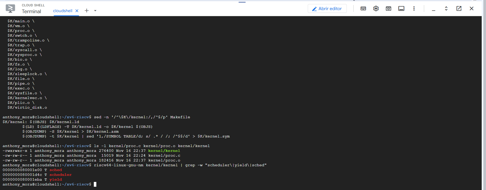

---

## 4. MLFQ y su incorporación a XV6

### 4.1 Descripción inicial de MLFQ (escrita antes de consultar a la IA)

**Parte 1: Idea general.** Según lo que vimos en el video, MLFQ (Multi-Level Feedback Queue) es un algoritmo de planificación que usa varias colas con diferentes prioridades y va moviendo los procesos entre ellas dependiendo de cómo se comporten. El profe decía que busca dos cosas: que los procesos cortos terminen rápido (*turnaround*) y que el sistema se sienta rápido para los usuarios (tiempo de respuesta). Lo más chévere es que no necesita saber de antemano cuánto tiempo va a durar un proceso, sino que lo va "aprendiendo" sobre la marcha a medida que ve si el proceso usa mucha CPU o si se la pasa esperando Entrada/Salida.

**Parte 2: Las reglas (como las entendimos).**

- **Regla 1:** Si un proceso A tiene más prioridad que un B, pues A se ejecuta y B se aguanta.
- **Regla 2:** Si A y B tienen la misma prioridad, se van turnando la CPU usando Round-Robin para que sea justo.
- **Regla 3:** Todo proceso que llega nuevo al sistema arranca con toda, en la cola de mayor prioridad.
- **Regla 4:** Si un proceso se pasa mucho tiempo usando la CPU, el sistema lo castiga y lo baja de cola. (Nota: nos enredamos un poco con lo de las reglas 4a y 4b del video. Creemos que si el proceso hace mucha E/S y suelta la CPU antes de tiempo, el sistema como que se apiada de él y lo sube a la cola más alta para que no sufra).
- **Regla 5:** Cada cierto tiempo "S" (que no sabemos bien cuánto es), los procesos que están abajo en las colas de menor prioridad vuelven a subir a la cola de más arriba. Creemos que esto es para que los procesos viejos y pesados no se mueran de inanición y puedan volver a usar la CPU.

**Parte 3: Nuestras dudas.**

1. ¿Cuántas colas son necesarias? No sabemos si hay un número mágico. En el video dijeron que Solaris usa como 60, pero nos parece una locura y no sabemos cómo se elige.
2. ¿El quantum cambia? Nos quedó la duda de si el tiempo de CPU (quantum) es igual en todas las colas. Nos pareció entender que en las colas de arriba el tiempo es cortico, pero no entendemos por qué abajo es más largo.
3. ¿Cómo se elige el tiempo "S"? El libro lo llama una "voo-doo constant" y la verdad nos da la impresión de que es puro empirismo. ¿Qué pasa si se configura mal?
4. El manejo de la E/S: si un proceso interactivo pasa mucho tiempo durmiendo esperando que el usuario escriba, ¿el sistema lo sigue contando como que está usando CPU, o cómo hace la contabilidad exacta para no bajarle la prioridad por error?

### 4.2 Prompt 1 enviado a la IA

Conversación nueva en Claude (claude.ai), modelo Claude Opus, el 16/11/2026. Es la plantilla del enunciado, sin cambios, con los dos campos completados: nuestra descripción inicial (4.1) y nuestra síntesis del planificador (sección 3).

<details>
<summary>Ver el prompt completo</summary>

```text
Actúa como tutor socrático de una pareja de estudiantes de cuarto semestre de Ingeniería de Sistemas. Conocemos C++ y hemos comenzado a explorar XV6 para RISC-V.

Queremos identificar y justificar qué se necesitaría para incorporar MLFQ a XV6. En esta entrega no vamos a implementarlo.

Nuestra descripción inicial del algoritmo, escrita antes de esta conversación:

Parte 1: Idea general
Según lo que vimos en el video, MLFQ (Multi-Level Feedback Queue) es un algoritmo de planificación que usa varias colas con diferentes prioridades y va moviendo los procesos entre ellas dependiendo de cómo se comporten. El profe decía que busca dos cosas: que los procesos cortos terminen rápido (turnaround) y que el sistema se sienta rápido para los usuarios (tiempo de respuesta). Lo más chévere es que no necesita saber de antemano cuánto tiempo va a durar un proceso, sino que lo va "aprendiendo" sobre la marcha a medida que ve si el proceso usa mucha CPU o si se la pasa esperando Entrada/Salida.

Parte 2: Las reglas (como las entendimos)
- Regla 1: Si un proceso A tiene más prioridad que un B, pues A se ejecuta y B se aguanta.
- Regla 2: Si A y B tienen la misma prioridad, se van turnando la CPU usando Round-Robin para que sea justo.
- Regla 3: Todo proceso que llega nuevo al sistema arranca con toda, en la cola de mayor prioridad.
- Regla 4: Si un proceso se pasa mucho tiempo usando la CPU, el sistema lo castiga y lo baja de cola. (Nota: Nos enredamos un poco con lo de las reglas 4a y 4b del video. Creemos que si el proceso hace mucha E/S y suelta la CPU antes de tiempo, el sistema como que se apiada de él y lo sube a la cola más alta para que no sufra).
- Regla 5: Cada cierto tiempo "S" (que no sabemos bien cuánto es), los procesos que están abajo en las colas de menor prioridad vuelven a subir a la cola de más arriba. Creemos que esto es para que los procesos viejos y pesados no se mueran de inanición y puedan volver a usar la CPU.

Parte 3: Nuestras dudas (lo que nos confunde)
1. ¿Cuántas colas son necesarias? No sabemos si hay un número mágico. En el video dijeron que Solaris usa como 60, pero nos parece una locura y no sabemos cómo se elige.
2. ¿El quantum cambia? Nos quedó la duda de si el tiempo de CPU (quantum) es igual en todas las colas. Nos pareció entender que en las colas de arriba el tiempo es cortico, pero no entendemos por qué abajo es más largo.
3. ¿Cómo se elige el tiempo "S"? El libro lo llama una "voo-doo constant" y la verdad nos da la impresión de que es puro empirismo. ¿Qué pasa si se configura mal?
4. El manejo de la E/S: Si un proceso interactivo pasa mucho tiempo durmiendo esperando que el usuario escriba, ¿el sistema lo sigue contando como que está usando CPU, o cómo hace la contabilidad exacta para no bajarle la prioridad por error?

Lo que averiguamos del planificador original y de su incorporación al sistema compilado:
- Ejecutamos XV6 (commit fa2ddcb, rama riscv) en QEMU con una sola CPU (make qemu CPUS=1, que pasa -smp 1 a QEMU).
- Con tres procesos que solo gastan CPU (spin & ; spin & ; spin &) vimos que sus salidas se intercalan y que en Ctrl+P siempre hay un solo proceso en "run" y los demás en "runble". Por eso creemos que XV6 usa Round Robin sin prioridades.
- La selección del siguiente proceso está en kernel/proc.c, función scheduler(): un ciclo infinito recorre el arreglo proc[] desde proc[0] hasta proc[NPROC-1] y elige el primero que esté en estado RUNNABLE; lo pone en RUNNING y hace swtch(&c->context, &p->context). Cuando el proceso devuelve la CPU, el ciclo sigue con el siguiente de la tabla. Si no hay ninguno listo, ejecuta wfi.
- La CPU se cede por dos caminos: (a) la interrupción del reloj: en kernel/trap.c, si which_dev == 2 se llama a yield() (kernel/proc.c), que pone el proceso en RUNNABLE y llama a sched(), que hace swtch de vuelta al planificador. clockintr() programa la siguiente interrupción con w_stimecmp(r_time() + 1000000), alrededor de una décima de segundo; (b) cuando el proceso espera algo: sleep() lo pone en SLEEPING y llama a sched(). wakeup(chan) lo vuelve a poner en RUNNABLE. Por ejemplo, la escritura en consola (kernel/uart.c, líneas 89-91) puede dormir al proceso. Nuestra versión usa sleep_prepare(chan) + sleep(), no sleep(chan, lock) como el libro.
- proc.c se compila a kernel/proc.o, que está en la lista OBJS del Makefile; todos los .o se enlazan con kernel/kernel.ld para producir kernel/kernel, que QEMU carga con -kernel. Con riscv64-linux-gnu-nm vimos scheduler, sched y yield dentro de kernel/kernel.

Reglas de interacción:

1. Formula una sola pregunta principal por turno y espera nuestra respuesta. No presentes una lista completa de cambios ni una arquitectura resuelta.
2. Empieza examinando nuestra descripción de MLFQ. Ayúdanos a detectar reglas ambiguas, ausentes o contradictorias. No sustituyas nuestra descripción por una versión terminada ni elijas silenciosamente una variante del algoritmo.
3. Pídenos que propongamos y justifiquemos las decisiones que faltan. Después, ayúdanos a comprobarlas con ejemplos pequeños de procesos y decisiones de planificación que nosotros debamos resolver.
4. Guíanos para relacionar cada regla con XV6. Antes de sugerir una modificación, pregúntanos qué comportamiento necesitamos y qué evidencia del código respalda nuestra propuesta.
5. No supongas que tienes acceso a nuestro repositorio. Pide los fragmentos necesarios y distingue lo observado de lo que todavía sea una hipótesis. No inventes archivos, funciones o comportamientos de nuestra versión.
6. No entregues código de implementación, parches, una lista cerrada de archivos por modificar ni pseudocódigo que resuelva el planificador. Revisa nuestras propuestas y señala problemas mediante preguntas y pistas graduales. Puedes explicar conceptos previos con ejemplos mínimos.
7. Si nos bloqueamos, reduce la dificultad de la pregunta y ofrece una pista concreta. Si pedimos la solución directa, conserva el modo socrático.

El objetivo es que nosotros logremos:

A. Redactar una descripción revisada y coherente de la variante de MLFQ considerada.
B. Explicar qué cambios necesitaría XV6 para soportarla, indicando para cada uno su propósito, su relación con las reglas y la evidencia del código que lo justifica.
C. Proponer escenarios para comprobar una futura implementación del algoritmo MLFQ en el sistema operativo XV6. Pídenos que expliquemos qué procesos participarían, qué harían, qué regla comprobaríamos y qué comportamiento esperaríamos observar. No nos entregues los escenarios resueltos. En esta tarea solo los describiremos; no vamos a programarlos ni ejecutarlos.

Mantén el análisis dentro del alcance de una propuesta: no necesitamos implementar MLFQ ni construir un selector de planificadores. Ayúdanos a registrar las cuestiones que queden pendientes de investigación.

Al finalizar, pídenos que redactemos nuestras conclusiones. Comprueba su consistencia mediante una última pregunta aplicada a un caso concreto, sin escribir por nosotros el reporte.

Comienza con una pregunta que permita comprobar cómo entendemos una regla de nuestra descripción inicial de MLFQ.
```

</details>

### 4.3 Descripción revisada de MLFQ

Variante que quedó al final del diálogo (decisiones tomadas por nosotros y revisadas con la IA):

- **Colas:** 3 colas, Q2 (alta), Q1 (media) y Q0 (baja).
- **Regla 1:** si la prioridad de A es mayor que la de B, corre A.
- **Regla 2:** si A y B tienen la misma prioridad, se turnan con Round-Robin usando el quantum de su cola. Los quantums crecen al bajar: **10 ms (Q2), 20 ms (Q1) y 50 ms (Q0)**. Cada turno recibe el quantum completo de su cola.
- **Regla 3:** todo proceso nuevo entra en Q2.
- **Regla 4 (contabilidad estricta):** cada proceso tiene un *allotment* de CPU por cola: **20 ms en Q2, 40 ms en Q1 e infinito en Q0**. Solo se cuenta tiempo de CPU (el tiempo dormido no cuenta). Cuando el proceso agota su allotment baja de cola, **sin importar cuántas veces haya soltado la CPU antes**: así se evita que un proceso "haga trampa" soltando la CPU justo antes del quantum.
- **Regla 5 (boost):** cada **S = 150 ms** todos los procesos suben a Q2 y sus contadores se reinician.

Decisiones que precisamos durante el diálogo:

- Se necesitan **dos contadores separados** por proceso: uno para el quantum (Regla 2, decide cuándo el RR pasa el turno) y otro para el allotment (Regla 4, decide cuándo baja de cola).
- Al **volver de una E/S** y al **cambiar de cola**, el proceso recibe un **quantum nuevo completo**.
- El contador de allotment **solo se reinicia al cambiar de cola o en el boost**; no se reinicia por hacer E/S.
- La comparación con el allotment se hace **cada vez que el contador aumenta**.
- **Bajar de cola no implica perder la CPU** por sí mismo.
- **Empate en un mismo instante** (un proceso agota su allotment justo cuando llega el boost): el resultado es el mismo en cualquier orden (el proceso termina en Q2 con su contador en cero). Si el boost va primero, el proceso se queda en Q2 porque el boost puso su contador en cero y la Regla 4 ya no ve que haya agotado nada. Qué evento tiene prioridad en el código queda como pendiente.
- **Relación para elegir S:** para que N procesos pesados alcancen a llegar a Q0 se necesita S > N × (allotment Q2 + allotment Q1). Con N = 2: 2 × (20 + 40) = 120 ms, por eso S = 150 ms (inicialmente habíamos propuesto 100 ms, que no cumplía la relación). Con procesos interactivos ocupando Q2, los pesados tardan aún más en bajar. Esa desigualdad es un límite inferior para S; la inanición pone un límite superior (cuanto más grande S, más inanición). Elegir un valor entre ambos según la carga es lo que el libro llama "voo-doo constant".

**Qué cambió respecto a la descripción inicial:** al principio creíamos que un proceso que hacía E/S rápido se quedaba en la cola alta o incluso subía a ella; nos dimos cuenta de que eso permitía hacer trampa (*gaming*). Ahora la Regla 4 lleva contabilidad estricta solo del tiempo de CPU. También resolvimos nuestras dudas 2 y 3 (quantums crecientes y cómo acotar S) y la 4 (el tiempo dormido no se cobra).

### 4.4 Propuesta de cambios en XV6

| # | Cambio propuesto | Archivo / función | Necesidad que atiende y por qué | Regla | Evidencia |
| --- | --- | --- | --- | --- | --- |
| 1 | Agregar a cada proceso un campo con su nivel de cola (prioridad) | `struct proc` en `kernel/proc.h` | Para aplicar la Regla 1 el planificador debe poder decir "este proceso tiene más prioridad que aquel". | 1 | **Observado:** `struct proc` no tiene ningún campo de prioridad (ver definición abajo); `scheduler()` solo mira `state`. |
| 2 | Agregar dos contadores por proceso: tiempo usado en el quantum actual y tiempo usado del allotment en la cola actual | `struct proc` en `kernel/proc.h` | El quantum (Regla 2) y el allotment (Regla 4) se reinician en momentos distintos, así que un solo contador no alcanza. | 2, 4 | Conclusión del diálogo (caso de P que usa 10 ms, luego 4 ms y hace E/S). |
| 3 | Elegir el proceso `RUNNABLE` de la cola más alta y aplicar Round-Robin dentro de esa cola | `scheduler()` en `kernel/proc.c` | Hoy toma el primer `RUNNABLE` de la tabla sin importar prioridad. | 1, 2 | **Observado:** el ciclo de `scheduler()` (sección 3.2). Cómo hacer el RR dentro de un nivel sin elegir siempre al mismo proceso queda pendiente. |
| 4 | Medir con exactitud el tiempo de CPU usado: marca de tiempo (`r_time()`) al **recibir** la CPU y al **entregarla**, y restar | Punto común de salida `sched()` en `kernel/proc.c` (y el punto donde se recibe la CPU) | El reloj de XV6 interrumpe cada ~100 ms, demasiado lento para quantums de 10 ms; además, a un proceso que usa 1 ms y duerme no se le debe cobrar un tick completo. | 2, 4 | **Observado:** `clockintr()` programa la siguiente interrupción con `r_time() + 1000000` (~0,1 s). **Hipótesis:** `r_time()` está en `kernel/riscv.h`; `yield()`, `sleep()` y `exit()` pasan por `sched()`. |
| 5 | Interrupción del reloj más frecuente | `clockintr()` en `kernel/trap.c` | Para que el Round-Robin respete quantums de 10/20/50 ms. | 2 | **Hipótesis:** modificar el intervalo `1000000` de `clockintr()`; hay que verificar el costo en rendimiento. |
| 6 | Asignar Q2 y contadores en cero al crear un proceso | `allocproc()` en `kernel/proc.c` | Regla 3: todo proceso nuevo entra en la cola más alta. | 3 | **Observado:** `allocproc()` existe en `kernel/proc.c`. Pendiente: si todos los procesos nacen por ahí (incluido el primero). |
| 7 | Cada S, recorrer la tabla de procesos y subir todos a Q2 reiniciando contadores | Usar el contador global `ticks` (`kernel/trap.c`) | Regla 5: evitar la inanición y permitir que un proceso que cambió de comportamiento recupere prioridad. | 5 | **Observado:** `ticks` está declarado en `kernel/trap.c` y `clockintr()` lo incrementa. Pendiente: qué *locks* usar y recalcular S en ticks si cambia el reloj. |
| 8 | Mostrar la cola de cada proceso en Ctrl+P | `procdump()` en `kernel/proc.c` | Los escenarios de prueba necesitan observar en qué cola está cada proceso. | Observabilidad | **Observado:** Ctrl+P llama a `procdump()` y hoy solo muestra PID, estado y nombre. |

Definición de `struct proc` en nuestro fork (`kernel/proc.h`, commit `fa2ddcb`):

```c
// kernel/proc.h
enum procstate { UNUSED, USED, SLEEPING, RUNNABLE, RUNNING, ZOMBIE };

// Per-process state
struct proc {
  struct spinlock lock;

  // p->lock must be held when using these:
  enum procstate state; // Process state
  void *chan;           // If non-zero, sleeping on chan
  int killed;           // If non-zero, have been killed
  int xstate;           // Exit status to be returned to parent's wait
  int pid;              // Process ID

  // wait_lock must be held when using this:
  struct proc *parent; // Parent process

  // these are private to the process, so p->lock need not be held.
  uint64 kstack;               // Virtual address of kernel stack
  uint64 sz;                   // Size of process memory (bytes)
  pagetable_t pagetable;       // User page table
  struct trapframe *trapframe; // data page for trampoline.S
  struct context context;      // swtch() here to run process
  struct file *ofile[NOFILE];  // Open files
  struct inode *cwd;           // Current directory
  char name[16];               // Process name (debugging)
};
```

No hay ningún campo de prioridad ni de tiempo de CPU usado: esa ausencia es la evidencia que justifica los cambios 1 y 2.

### 4.5 Decisiones que requieren más investigación

1. **El reloj:** verificar cómo funciona `r_time()` (registro CSR `time`) y si es viable interrumpir más seguido sin afectar el rendimiento; recalcular S en ticks si se cambia el intervalo del reloj.
2. **Cambio de contexto y cobro de tiempo:** confirmar que `sched()` es el punto común por donde pasan `yield()`, `sleep()` y `exit()`, y si siempre se llama a `swtch()` aunque no haya otro proceso listo, para no cobrar mal el tiempo.
3. **El ciclo de `scheduler()`:** si se busca por prioridad, ¿cómo evitar que el Round-Robin se rompa y se elija siempre al mismo proceso de la cola alta?
4. **Empate boost / Regla 4:** definir qué evento tiene prioridad en el código cuando ocurren en el mismo instante.
5. **Concurrencia en el boost:** el boost recorre toda la tabla de procesos; hay que ver qué *locks* usar para no romper el sistema.
6. **El primer proceso:** ¿nace por `allocproc()` o por otro camino?
7. **Procesos interactivos que bajan:** con S = 150 ms, un proceso solo baja de Q2 si usa más de 20 ms de CPU dentro de un intervalo de 150 ms. ¿Qué tan intensivo tiene que ser un proceso interactivo para que baje, y es eso lo que queremos? (reformulado con la retroalimentación de la IA)
8. **Escenarios:** controlar el proceso escritor del *pipe* para que la E/S dure lo previsto, evitar que el proceso que imprime se duerma por la consola, y no superar el límite de `NPROC` en la "fábrica" de procesos.

### 4.6 Escenarios para comprobar una futura implementación

Solo descritos; no se programaron ni ejecutaron. Todos suponen `CPUS=1` y el cambio 8 (`procdump()` muestra la cola).

| Escenario | Procesos que participan | Qué hacen | Regla que se comprueba | Comportamiento esperado si es correcto |
| --- | --- | --- | --- | --- |
| 1. Anti-trampas | **B** ("tramposo") y **C** (pesado) | B usa CPU y hace E/S con *pipes* soltando la CPU justo antes de agotar su quantum; C solo usa CPU. Se usa un S muy grande para que el boost no interfiera. | Regla 4 (contabilidad estricta) | Con Ctrl+P se ve que **ambos terminan cayendo a Q0**. Si B se queda en Q2, la Regla 4 falló. |
| 2. Rescate | Un proceso **pesado** y una **"fábrica"** que crea continuamente procesos interactivos | La fábrica mantiene Q2 siempre ocupada (por la Regla 3, todo proceso nuevo entra en Q2); los hijos no deben dormir demasiado para no vaciar Q2. El pesado imprime un contador, no muy seguido (la consola lo puede dormir). Se hacen dos corridas: S muy grande y S normal. | Regla 5 (boost contra la inanición) | Con S muy grande, el contador del pesado **se congela** (inanición); con S normal **sigue avanzando** gracias al boost. Cuidados: si la fábrica baja a Q0 se turna con el pesado y deja de llenar Q2; no superar `NPROC`. |
| 3. Interactivo frente a pesados (de la pregunta final del diálogo) | **D** (editor: 1 ms de CPU por tecla, una tecla cada ~500 ms) y dos pesados **C1** y **C2**, todos desde t = 0, durante 1 s, con S = 150 ms | D casi siempre duerme; C1 y C2 compiten por la CPU. | Reglas 2 y 4 (cobro exacto de tiempo) y relación de S | **D sigue en Q2** en t = 1 s (usa unos 2 o 3 ms de CPU, lejos de los 20 ms del allotment). **C1 y C2 están en Q0 justo antes del primer boost** (a los 40 ms bajan a Q1 y a los 120 ms a Q0). A D se le cobra 1 ms y no 100 gracias a las marcas de tiempo al recibir y al entregar la CPU (cambio 4). |

### 4.7 Conclusiones y retroalimentación de la IA

**Nuestras conclusiones (versión final, corregida durante el diálogo):**

> **1. Descripción final de MLFQ y decisiones cambiadas (A).** Usamos 3 colas (Q2, Q1, Q0) con quantums de 10, 20 y 50 ms. Los allotments son 20 ms (Q2) y 40 ms (Q1). Cambio importante: decidimos que S = 150 ms, porque nuestra propia relación exige que S sea mayor a 120 ms para que dos procesos pesados alcancen a llegar a Q0. El cambio respecto a la idea inicial es que ya no permitimos que las E/S salven a un proceso tramposo; la Regla 4 cuenta solo tiempo de CPU y es estricta. Además, al volver de una E/S y al cambiar de cola, el proceso recibe un quantum nuevo completo, y el Priority Boost (Regla 5) reinicia todos los contadores a cero.
>
> **2. Cambios propuestos para XV6 (B).** Regla 1 (prioridad): agregar un campo de prioridad en `struct proc`, que hoy no existe (observado en `proc.h`). Reglas 2 y 4 (tiempo): necesitamos un reloj más frecuente para que el Round-Robin se respete (hipótesis: modificar el intervalo de `clockintr`) y usar marcas de tiempo exactas (`r_time()`) al recibir y al entregar la CPU (hipótesis: `r_time` está en `riscv.h`). Regla 3 (nuevos procesos): asignar prioridad alta al crear el proceso en `allocproc()` (observado en `proc.c`). Regla 5 (boost): usar la variable `ticks` de `trap.c` (observado) para hacer el boost cada S. Observabilidad: modificar `procdump()` (observado en `proc.c`) para que muestre la cola de cada proceso.
>
> **3. Escenarios de prueba (C).** Anti-trampas: B (usa E/S por *pipes*) contra C (pesado); con S gigante, ambos deben caer a Q0. Rescate: un pesado contra una fábrica de procesos interactivos; con S normal, el contador del pesado avanza; con S gigante, se congela.
>
> **4. Pendientes.** Los de la sección 4.5.

**Pregunta final de la IA y nuestras respuestas** (caso del editor D con C1 y C2, ver escenario 3):

> (1) Declaramos S = 150 ms. Sí cumple la relación, porque para N = 2 (C1 y C2) la suma de los allotments es 20 + 40 = 60 ms por proceso; 2 × 60 = 120 ms, y como 150 > 120, los procesos alcanzan a bajar a Q0 antes del boost.
> (2) D está en Q2. Usa 1 ms de CPU, duerme 500 ms, usa 1 ms, etc.; su contador de allotment va sumando de a 1 ms y no llega a los 20 ms.
> (3) Justo antes del primer boost (t = 150 ms) esperamos ver a C1 y C2 en Q0. Como D está dormido casi todo el tiempo, C1 y C2 se reparten la CPU: a los 40 ms ambos agotan Q2 y bajan a Q1; a los 120 ms ambos agotan Q1 y caen a Q0. Les sobran 30 ms en el fondo antes del boost.
> (4) El cambio de usar marcas de tiempo (`r_time()`) al recibir y al entregar la CPU: el sistema calcula la diferencia exacta (1 ms) en vez de esperar la interrupción del reloj de 100 ms y cobrarle el tick completo.

**Retroalimentación de la IA (resumen):** las respuestas son coherentes con las conclusiones y la cuenta de C1 y C2 está bien hecha. Nos señaló tres ajustes: (a) para explicar por qué D sigue en Q2 no hace falta el boost (en 1 s usa 2 o 3 ms de CPU), y eso permite reformular el pendiente de D (pendiente 7); (b) el punto 1 de las conclusiones había perdido decisiones que sí tomamos (dos contadores, quantum nuevo al volver de E/S y al cambiar de cola, contadores que se reinician al bajar y en el boost, comparación cada vez que el contador aumenta, bajar de cola no implica perder la CPU), que recogemos en la sección 4.3; (c) separar lo observado de lo hipotético: lo observado en `proc.h` es que el campo de prioridad **no existe**, y la marca de tiempo se necesita al recibir y al entregar la CPU. Su cierre: *"Empezaron con una Regla 4 que se podía engañar y terminaron con una variante coherente, cada cambio en XV6 justificado con evidencia o marcado como hipótesis, y escenarios con predicciones que se pueden verificar."*

---

## 5. Evidencia del aprendizaje con IA

**Servicio de IA:** Claude (claude.ai) · **Modelo:** Claude Opus · **Fecha:** 16/11/2026 · Conversación nueva iniciada con el Prompt 1 (sección 4.2).

### 5.1 Intercambios significativos del diálogo socrático

**Intercambio 1 — Corrección (aplicar nuestra propia Regla 2).**

> **IA:** Revisen la línea t = 80 a 100 ms. Escribieron que C1 usa 10 ms y luego C2 usa 10 ms. Pero en Q1 el quantum es de 20 ms, y su propia Regla 2 corregida dice que cada turno recibe el quantum completo de su cola. ¿Por qué C1 soltaría la CPU a los 10 ms si no hace E/S y su quantum no se ha acabado? […] Si hacen bien la cuenta, van a ver que en t = 100 ms pasan dos cosas a la vez. Díganme cuáles son y si el orden en que el sistema las aplique cambia el resultado para C1.
>
> **Nosotros:** Tienes toda la razón, se nos fue el detalle más importante de nuestra propia Regla 2. […] Como el quantum de Q1 es de 20 ms, C1 corre sus 20 ms completos (no 10). Al llegar a t = 100 ms, C1 termina su quantum y, como venía con 20 ms en su contador, llega justo a su límite de 40 ms (el allotment de Q1). Ocurren dos cosas al mismo tiempo: por la Regla 4, C1 agota su allotment y debe bajar a Q0; por la Regla 5, llega el boost (S = 100 ms) y todos deben subir a Q2.

**Intercambio 2 — Hipótesis (relación para elegir S).**

> **IA:** Para que un proceso pesado llegue a Q0 aunque compita con otros, ¿qué relación debería cumplir S con la suma de los allotments de Q2 y Q1 y con el número de procesos pesados?
>
> **Nosotros:** El tiempo S tiene que ser mayor a la suma de los allotments de Q2 y Q1, multiplicada por el número de procesos pesados: S > N × (Allotment_Q2 + Allotment_Q1). Si S es más corto, el boost llega antes de que terminen de bajar y nadie llega al fondo (como nos pasó con S = 100 ms).
>
> **IA:** Su relación tiene la forma correcta. […] Esa relación supone que solo hay procesos pesados […]. Su desigualdad pone un límite inferior a S, y la inanición pone un límite superior. Eso es justamente la "voo-doo constant".

**Intercambio 3 — Corrección (el razonamiento del empate).**

> **IA:** El resultado que obtuvieron es correcto, pero la razón que dieron no. Si el boost va primero, C1 no se queda en Q2 "porque Q2 es la más alta", ya que desde Q2 sí se puede bajar, a Q1. Se queda en Q2 porque el boost puso su contador en cero, y la Regla 4 ya no ve que haya agotado nada.
>
> **Nosotros:** El error fue nuestro: no caímos en cuenta de que el boost reinicia el contador a cero, entonces la Regla 4 literalmente "no ve" que C1 agotó su tiempo. Lo dejamos anotado exactamente así en los pendientes.

**Intercambio 4 — Comprobación con evidencia del código.**

> **IA:** ¿Qué información, por cada proceso, necesitaría tener `scheduler()` para decidir según la Regla 1, y existe hoy en XV6? […] Peguen aquí la definición de `struct proc` de su versión (está en `kernel/proc.h`) y señalen qué campos sirven y cuáles faltan.
>
> **Nosotros:** Para decidir "quién tiene más prioridad", el planificador necesita saber el nivel de prioridad (o la cola) de cada proceso. Revisando los campos actuales, `scheduler()` solo mira el campo `state`, pero no existe ningún campo que guarde la prioridad. Tal como está XV6 hoy, el planificador es "ciego" a las prioridades.
>
> **IA:** Sí, van bien, y lo justificaron con evidencia. […] En el reporte, citen la definición tal como está en su fork (con la ruta y el commit `fa2ddcb`).

**Intercambio 5 — Comprobación de coherencia (pregunta final).** Ver la sección 4.7: la IA planteó el caso del editor D con dos procesos pesados y nos pidió que, si alguna respuesta contradecía las conclusiones, corrigiéramos las conclusiones y no la respuesta. Así detectamos que S = 100 ms contradecía nuestra relación y lo cambiamos a 150 ms.

### 5.2 Otros usos de IA

- **Claude (claude.ai), en una conversación aparte de la socrática:** nos guio paso a paso en lo técnico. Nos advirtió que la VM de Vagrant no servía por la versión de QEMU, nos dio los comandos de instalación, compilación y lectura de código, el programa de prueba `user/spin.c` y el comando para agregarlo al `Makefile`, y nos explicó el código de `scheduler()`, `yield()`, `sched()`, `sleep()`, `wakeup()` y el proceso de compilación. También armó la síntesis del planificador incluida en el Prompt 1 a partir de nuestras respuestas de la sección 3, y organizó este reporte con nuestras respuestas, capturas y fragmentos del diálogo socrático.
- **NotebookLM (Google):** para la sección 3.3 consultamos NotebookLM, que redactó un borrador a partir de nuestras capturas; lo reescribimos con nuestras palabras.

### 5.3 Reflexión individual

**Anthony Alejandro Mora Melo:** Antes de esta tarea, la verdad no terminaba de entender cómo el sistema operativo decidía qué proceso corría; pensaba que era un poco mágico. Al hacer el experimento con los tres procesos `spin` y ver las vueltas intercaladas en la consola, ya me quedó clarísimo que es un Round-Robin puro y duro el que recorre la tabla en `scheduler()`. Mi mayor aporte al equipo fue montar el entorno (que nos dio dolores de cabeza con las versiones de QEMU 7.2 y Vagrant) y armar el ejemplo donde nos dimos cuenta de que un proceso podía hacer trampa soltando la CPU antes de tiempo. Siento que todavía me falta estudiar bien cómo hacer la contabilidad exacta del tiempo de CPU para que el reloj lento de XV6 no nos arruine los quantums, y cómo elegir el bendito valor de "S" (la voo-doo constant) sin que los procesos pesados mueran de hambre.

**Roiban Alirio Bastidas Rosales:** Lo que más me sirvió hoy fue entender la diferencia real entre quantum y allotment, y ver directamente en el código cómo `sleep()` manda al proceso a `SLEEPING` y `wakeup()` lo vuelve a poner `RUNNABLE`. Mi aporte fue revisar los archivos `trap.c` y `proc.c` para buscar de dónde salía el reloj, y ayudar a corregir las cuentas de la línea de tiempo cuando C1 llegaba a Q0 (¡nos habíamos equivocado feo sumando los tiempos y el quantum!). También saqué la fórmula de la relación de S para que los procesos pesados no se queden atascados arriba. Aún me queda pendiente estudiar a fondo cómo funciona `r_time()` a nivel de hardware, ver cómo resolver el empate cuando el boost choca con el fin de un allotment, y confirmar si acelerar el reloj no va a generar tanto overhead que termine haciendo el sistema más lento.
